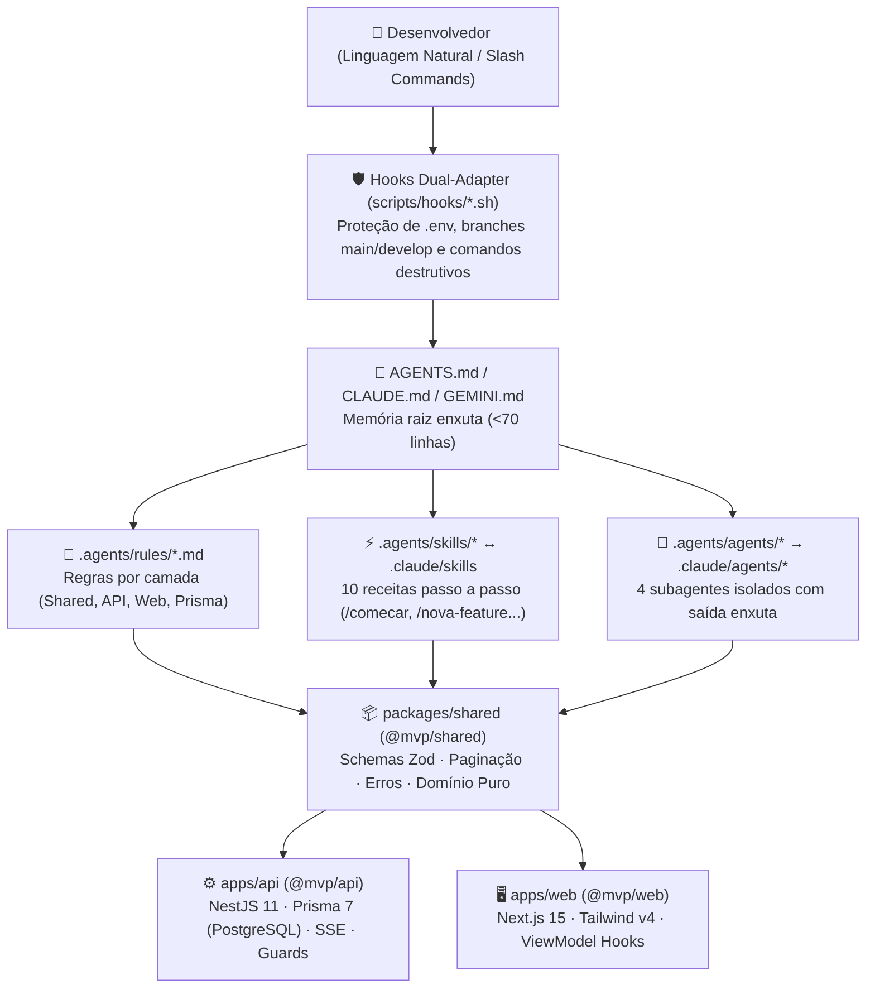

# Universal Agentic MVP Template

> Um ponto de partida enxuto e de engenharia sólida para construir **qualquer MVP em produção** usando linguagem natural — projetado para funcionar nativamente tanto no **Google Antigravity (`agy`)** quanto no **Claude Code (`claude`)**.

Você descreve o que o sistema precisa fazer em português; o agente constrói seguindo contratos compartilhados em Zod, camadas isoladas no Backend e Frontend, economia de tokens (*Progressive Disclosure*) e travas automáticas de qualidade e segurança.

O template já vem com uma funcionalidade molde — **Tarefas (`tasks`)** — funcionando de ponta a ponta (contrato Zod, banco PostgreSQL via Prisma, API NestJS, tela Next.js com os 4 estados visuais e testes no Vitest). Quando você for começar o seu domínio real, basta pedir ao agente: `/remover-exemplo` e `/renomear-projeto`.

---

## Pré-requisitos

| Ferramenta | Versão | Para quê |
| :--- | :--- | :--- |
| **Node.js** | `>= 22 LTS` (recomendado `24 LTS`) | Executa a API, o Frontend e os scripts |
| **pnpm** | `9.x` (via Corepack: `corepack enable`) | Gerencia os pacotes do monorepo |
| **Docker** *(opcional)* | Qualquer recente | Sobe o PostgreSQL local com 1 comando (ou use Neon/Supabase gratuito na nuvem) |
| **Git** | Qualquer recente | Histórico de código e fluxo de branches |
| **Antigravity (`agy`)** e/ou **Claude Code (`claude`)** | — | Agentes de IA que constroem e revisam com você |

---

## Criando um novo MVP a partir deste Template

### Caminho 1 — Com Agente de IA (Recomendado)
1. No GitHub, clique em **Use this template → Create a new repository**.
2. Clone o novo repositório na sua máquina e abra na sua IDE ou terminal (`agy` ou `claude`).
3. Digite `/comecar` — o agente confere o ambiente, cria os arquivos `.env`, sobe o banco, aplica migrations/seed e explica o projeto.
4. Digite `/renomear-projeto` para colocar o nome do seu produto nas telas, pacotes e documentação.
5. Quando quiser apagar a feature molde de Tarefas para iniciar seu domínio, digite `/remover-exemplo`.

### Caminho 2 — Manualmente no Terminal (5 comandos)
```bash
cp .env.example .env && cp .env.example apps/api/.env
docker compose up -d postgres   # Ou aponte DATABASE_URL para Neon/Supabase no .env
pnpm install                    # Instala dependências e gera Prisma Client + build do @mvp/shared
pnpm db:migrate && pnpm db:seed # Cria tabelas e grava dados iniciais idempotentes
pnpm dev                        # Sobe Shared (watch), API (:3333) e Web (:3000)
```

- **Aplicação Web (Next.js):** http://localhost:3000
- **API Backend (NestJS):** http://localhost:3333/api/health
- **Documentação Swagger:** http://localhost:3333/docs

---

## Arquitetura Universal de Agentes + Monorepo

Este template evita o erro clássico de colocar manuais gigantes em contexto fixo (*context rot*). As instruções são divididas em camadas carregadas sob demanda e compartilhadas entre `.agents/` (Antigravity) e `.claude/` (Claude Code) sem duplicar arquivos:



---

## Como pedir funcionalidades ao Agente

Fale do **resultado de negócio**, não de detalhes de implementação:
- *"Quero cadastrar clientes com nome, telefone e cidade, com busca por nome e filtro por cidade."*
- *"Adicione um campo de observação opcional no cadastro e mostre na listagem."*
- *"Gere dados de teste com 15 registros variados para eu testar a paginação."*
- *"Rode `/verificar` para garantir que está tudo pronto para abrir PR."*

---

## Catálogo de Skills (`/comando`) e Subagentes

### Skills Disponíveis (Antigravity & Claude Code)

| Skill | Para que serve |
| :--- | :--- |
| `/comecar` | Onboarding completo: checa ambiente, `.env`, banco, migrations, seed e sobe o sistema |
| `/renomear-projeto` | Troca o escopo `@mvp/*`, títulos e metadados para o nome do seu novo produto |
| `/nova-feature` | Cria uma funcionalidade inteira: Shared (Zod) → Prisma (DB) → NestJS (API) → Next.js (Web) → Testes |
| `/banco-de-dados` | Cria/altera models Prisma, gera migrations SQL, aplica no Postgres ou abre o Prisma Studio |
| `/componente-ui` | Cria componentes visuais acessíveis em Tailwind v4 respeitando os 4 estados de tela |
| `/dados-de-teste` | Cria ou atualiza seeds idempotentes em `apps/api/prisma/seed.ts` |
| `/verificar` | Bateria completa de qualidade: `typecheck` + `lint` (`--max-warnings=0`) + `test` + `build` |
| `/git-commit` | Salva alterações em commits semânticos padronizados (`[tipo](escopo): Mensagem`) |
| `/git-fluxo` | Ciclo seguro de trabalho: cria `feature/<nome>` a partir de `develop`, valida e faz merge após seu OK |
| `/remover-exemplo` | Remove com segurança a feature molde `tasks` de todas as camadas |

### Time de Subagentes Isolados
- **`codebase-explorer`**: Mapeia arquivos e fluxos em paralelo sem poluir o contexto principal.
- **`db-architect`**: Especialista em modelagem PostgreSQL, índices, transações e seeds no Prisma.
- **`security-auditor`**: Audita exposição de segredos, validação Zod, Guards e OWASP antes de entregas.
- **`qa-tester`**: Executa `typecheck`, `lint`, `test` e `build` devolvendo apenas o diagnóstico enxuto.

---

## Estrutura enxuta do Repositório

```text
.
├── AGENTS.md · CLAUDE.md · GEMINI.md   # Memória enxuta para os agentes de IA
├── CONTRIBUTING.md · SUPORTE.md        # Convenções de engenharia e checklist pós-clone
├── docker-compose.yml                  # PostgreSQL 16 local pronto para uso
├── eslint.config.mjs                   # ESLint 9 Flat Config compartilhado (--max-warnings=0)
│
├── .agents/                            # Fonte da verdade agêntica (Antigravity)
│   ├── rules/                          # Regras modulares (Segurança, Shared, API, Web, Prisma)
│   ├── agents/                         # Definições dos 4 subagentes
│   ├── skills/                         # As 10 skills operacionais
│   └── hooks.json                      # Guardrails automáticos no loop do agente
│
├── .claude/                            # Compatibilidade nativa Claude Code
│   ├── settings.json                   # Permissões e hooks apontando para scripts/hooks/
│   ├── agents/                         # Sincronizado via `pnpm agents:sync`
│   └── skills -> ../.agents/skills     # Symlink direto (zero duplicação)
│
├── packages/
│   └── shared/                         # @mvp/shared — Schemas Zod, Paginação, Erros e Domínio Puro
│
├── apps/
│   ├── api/                            # @mvp/api — NestJS 11 + Prisma 7 (PostgreSQL) + Swagger + SSE
│   └── web/                            # @mvp/web — Next.js 15 (App Router) + Tailwind v4 + ViewModels
│
└── scripts/
    ├── sync-agents.mjs                 # Tradutor automático .agents/agents -> .claude/agents
    └── hooks/                          # Motor Dual-Adapter de segurança (Node.js puro, sem jq)
```

---

## Stack Tecnológica

| Camada | Escolha | Motivo |
| :--- | :--- | :--- |
| **Monorepo** | `pnpm workspaces` | Rápido, determinístico e isolamento real de dependências |
| **Contratos & Domínio** | TypeScript Strict + **Zod** | O mesmo schema valida a API e o Frontend sem duplicar tipos |
| **Backend** | **NestJS 11** + Swagger + SSE | Arquitetura modular (`Controller → Service → Repository`), Guards e eventos em tempo real |
| **Banco & ORM** | **PostgreSQL** + **Prisma 7** (`@prisma/adapter-pg`) | Suporta múltiplos dispositivos simultâneos na nuvem (Neon/Supabase grátis) e relações aninhadas simples |
| **Frontend** | **Next.js 15** (App Router) + **Tailwind CSS v4** | Deploy imediato na Vercel, SSR/SEO nativo e separação limpa via ViewModel Hooks |
| **Qualidade & CI** | **Vitest** + **ESLint 9** + **GitHub Actions** | Testes rápidos em único runner, zero warnings tolerados e validação automática a cada PR |

---

## Comandos Oficiais (sempre na raiz)

| Comando | O que faz |
| :--- | :--- |
| `pnpm dev` | Sobe `@mvp/shared` (watch), `@mvp/api` (`:3333`) e `@mvp/web` (`:3000`) em paralelo |
| `pnpm typecheck` | Confere os tipos estritos em todos os pacotes |
| `pnpm lint` | Roda ESLint 9 em todos os pacotes com `--max-warnings=0` |
| `pnpm test` | Executa toda a suíte de testes unitários no Vitest |
| `pnpm build` | Compila versão de produção do Shared, API e Web |
| `pnpm db:generate` | Cria nova migration SQL do Prisma (`--create-only`) após alterar `schema.prisma` |
| `pnpm db:migrate` | Aplica as migrations pendentes no PostgreSQL |
| `pnpm db:seed` | Popula dados de teste idempotentes |
| `pnpm db:reset` | Limpa o banco de desenvolvimento, reaplica migrations e roda o seed |
| `pnpm db:studio` | Abre o Prisma Studio no navegador para visualizar/editar tabelas |
| `pnpm agents:sync` | Sincroniza alterações de `.agents/agents/*.md` para `.claude/agents/*.md` |

---

## Segurança e Governança de Branches

- **Segredos blindados:** Os hooks em `scripts/hooks/` impedem que agentes leiam ou façam commit de arquivos `.env`, chaves `.pem`/`.key` ou credenciais. Apenas `.env.example` é versionado.
- **Proteção de `main` e `develop`:** Commits e pushes diretos nas branches principais são bloqueados automaticamente pelos hooks. Todo desenvolvimento ocorre em `feature/<nome>` ou `fix/<nome>`.
- **Modo Administrador (apenas para mantenedores do repositório):** Para realizar operações administrativas diretamente nas branches protegidas na sua máquina local, rode:
  ```bash
  git config project.admin true
  ```

Consulte [CONTRIBUTING.md](CONTRIBUTING.md) para detalhes das convenções de código e [SUPORTE.md](SUPORTE.md) para o checklist pós-clone e resolução de problemas comuns.

